# Pixel Art Tree Wind Lab 🌳💨

[日本語](README.md) | **English**

A lab that rebuilds — and takes apart — a technique for making pixel-art trees move convincingly in the wind, live in your browser.
Zero dependencies: plain JavaScript (ES modules) paints the trees, splits them into clumps, simulates the wind and renders the scene.

### ▶ [Play it in your browser (GitHub Pages)](https://kumi0708.github.io/pixel-art-tree-wind-lab/)

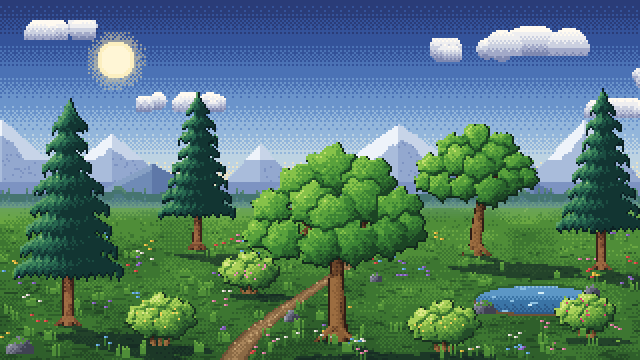

> The technique comes from the SpriteCook article **[How to make pixel art trees move in the wind](https://www.spritecook.ai/blog/pixel-art-trees-wind-animation)**.
> The article splits trees in Python (numpy / scipy / scikit-image) and animates them in Godot. This repository re-implements the same ideas **in JavaScript only** and paints its own trees procedurally. All code and art were written from scratch for this repository.

---

## Contents

1. [What you can do](#what-you-can-do)
2. [The pipeline at a glance](#the-pipeline-at-a-glance)
3. [① Paint the tree as one flat image](#-paint-the-tree-as-one-flat-image)
4. [② Split the canvas into leaf clumps](#-split-the-canvas-into-leaf-clumps)
5. [③ Each clump walks a one-pixel loop](#-each-clump-walks-a-one-pixel-loop)
6. [④ Time the clumps with a traveling wave](#-time-the-clumps-with-a-traveling-wave)
7. [⑤ Gusts, with still air between them](#-gusts-with-still-air-between-them)
8. [⑥ The whole tree leans on a damped spring](#-the-whole-tree-leans-on-a-damped-spring)
9. [⑦ The pine bends its trunk, row by row](#-the-pine-bends-its-trunk-row-by-row)
10. [⑧ Everything else rides the same wind](#-everything-else-rides-the-same-wind)
11. [Why this method (vs. the naive ones)](#why-this-method)
12. [Parameters](#parameters)
13. [Files](#files)
14. [Run it locally / regenerate the figures](#run-it-locally)

---

## What you can do

| Feature | What it does |
|---|---|
| **Views** | normal / color each clump / heat-map of clump weight `w` |
| **Overlays** | gust field (heat-map) and traveling-wave phase (white lines are crests) |
| **Method comparison** | article method / one sine for everything / random jitter |
| **Components on/off** | traveling wave, gusts, spring, inside layer, 10 Hz stepping, shadows, falling leaves |
| **World** | playback speed, wind strength, new seed (re-paints and re-splits the trees on the spot) |
| **Graph** | live plot of target lean vs. actual lean for the selected tree |
| **Split pipeline** | all nine intermediate images, generated in your browser |

Click a tree on the stage to follow it in the graph. Space pauses.
In the devtools console you can poke the simulation through `lab.scene` (e.g. `lab.scene.trees[5].p.push = 6`).

---

## The pipeline at a glance

```
 ┌──────────────┐   ┌──────────────────────┐   ┌───────────────────────┐   ┌───────────────┐
 │ one flat     │ → │ offline split        │ → │ per-frame wind        │ → │ draw at 320×180│
 │ tree image   │   │ colour masks → blur → │   │ wave + gusts + spring │   │ whole pixels → │
 │ treegen.js   │   │ seeds → watershed    │   │ wind.js / tree.js     │   │ nearest upscale│
 └──────────────┘   │ split.js             │   └───────────────────────┘   └───────────────┘
                    └──────────────────────┘
```

Four rules carry the whole thing: **keep the trunk still, move only leaf clumps, move in whole pixels, use no randomness.**
Everything is drawn into a tiny software framebuffer (`Uint32Array`) at 320×180 and scaled up at the end with CSS `image-rendering: pixelated`, so every offset is an integer by construction and nothing ever smears across sub-pixels.

---

## ① Paint the tree as one flat image

The article starts from an artist's tree sprite. There is no artist here, so [`src/core/treegen.js`](src/core/treegen.js) paints the tree **as a single flat image**.
The key point: the generator **never tells** the splitter where the clumps are. The splitter has to find them again from colour and light alone.

- **Trunk & branches** — tapered capsules; each pixel keeps the nearest limb axis, gets cylinder lighting (light from the upper-left), and is quantized into five bark tones with dithering. Thick limbs get an outline; grooves come from hash noise.
- **Canopy (oak, bush)** — "puffs" stacked back-to-front. Each puff is **lit as its own little sphere**, so each one ends up with a bright core. That core is exactly what the splitter later latches onto.
  - edges wobble with `sin(6θ)` and `sin(11θ)` for a leafy silhouette
  - the back puff darkens right where a front puff overlaps it (ambient occlusion)
  - 4×4 Bayer dithering into a 7-tone palette
  - a selective outline (dark only on the lower-right) and a few stray single-pixel leaves
- **Pine** — eight drooping branch tiers, each lit from the upper-left, each underside shaded by the tier above, with a saw-tooth hem.

---

## ② Split the canvas into leaf clumps

[`src/core/split.js`](src/core/split.js) is a JavaScript port of the article's Python pipeline (numpy / scipy / scikit-image). The page's "Split pipeline" panel runs it live in your browser (a few milliseconds per oak).

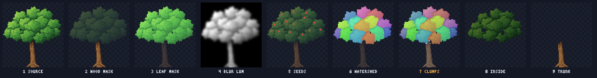

| # | Stage | What happens |
|---|---|---|
| 1 | SOURCE | the procedurally painted flat image |
| 2 | WOOD MASK | **wood** = hue 5–40°, saturation > 0.22, luminance < 125. **pale bark** = saturation < 0.16, luminance > 95 (shown white) |
| 3 | LEAF MASK | **leaves** = opaque, neither wood nor bark, and in the **top 78 %** of the sprite's opaque rows |
| 4 | BLUR LUM | luminance blurred with a Gaussian, σ = 1.6 (like `scipy.ndimage.gaussian_filter`, separable kernel) |
| 5 | SEEDS | **local maxima** of the blurred luminance (`skimage.feature.peak_local_max`, min distance 5 px; 3 px for bushes) |
| 6 | WATERSHED | `watershed(-blur, seeds, mask=leaves)`: a priority-queue flood that grows from each bright core into the next-brightest neighbour (4-connected) |
| 7 | CLUMPS | clumps that are too small (< 25 px; bush 10) or too low (mean y below `last_row − height × trunk_part`) go back to the trunk. **White** = outline pixels handed over by `add_outline` |
| 8 | INSIDE | the union of all clumps, eroded by 2 px, RGB × 0.55 |
| 9 | TRUNK | every pixel in no clump — the layer that never moves |

**add_outline (reach 2)** — brown pixels on the silhouette (transparency within 2 px) move to the adjacent clump unless they are closer to the trunk body or to pale bark. That way twig tips sticking out of the canopy travel with their leaves, instead of a brown rim being left behind.

For this seed the oak ends up with **14 clumps**, the pine with **8 tiers** and the bush with **4 clumps** — the same counts as the article's examples.

<table>
<tr>
<td>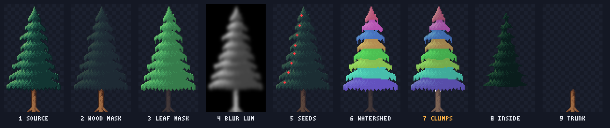</td>
</tr>
<tr>
<td>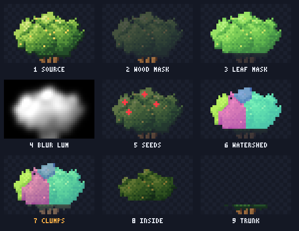</td>
</tr>
</table>

Exploded, the layers look like this. Draw order is **inside → trunk → clumps** (pine tiers bottom-up; broadleaf clumps back/top first, front/bottom last).

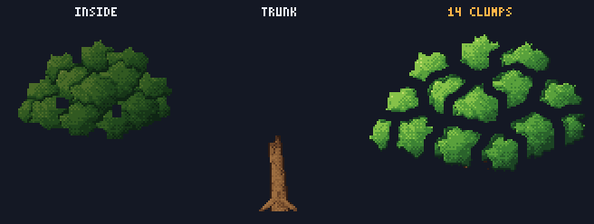

### Why the inside layer matters

When a clump moves, it leaves a hole where it used to be, and sky or background shows through. So a slightly smaller, darker copy of the canopy sits underneath: whatever peeks through the gap reads as **the shady depths of the tree**.

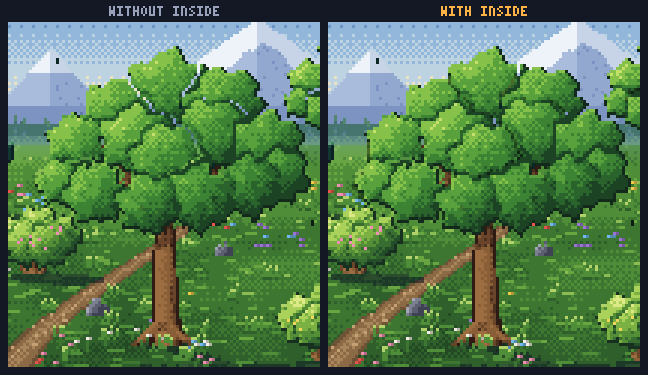

On the left (no inside layer) sky and background leak between clumps; on the right they read as leaves in shadow.

---

## ③ Each clump walks a one-pixel loop

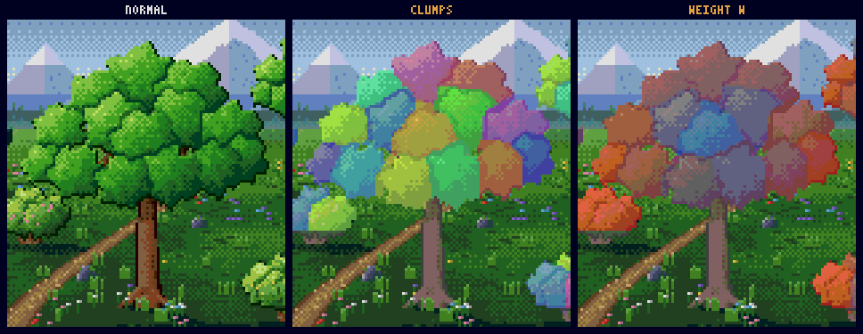

Every 0.1 s (10 Hz) each clump picks a whole-pixel offset (`a` is the wave phase, below):

```js
ride = lean * lerp(w, hn * hn, trunk_bend)          // the part that rides the tree's lean
dx   = ride + w * (0.9 * breeze + 1.3 * gust) * (0.5 - 0.5 * cos(a))
dy   =      - w * (0.75 * breeze + 0.5 * gust) * max(sin(a), 0)
pos  = rest + (round(dx), round(dy))
```

With `breeze = 1, gust = 0, w = 1`, one period walks **(0,0) → (0,−1) → (1,−1) → (1,0)**: up, right, down, back — a tiny square. With `w = 0.35` (inner canopy) rounding keeps it at (0,0).

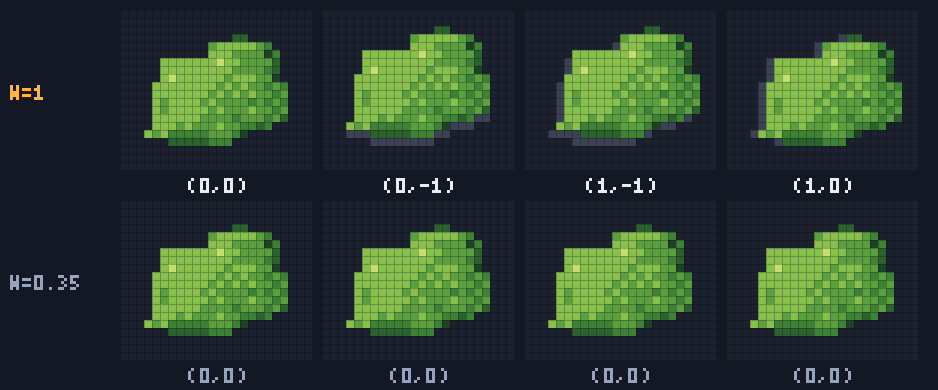

- **Clump weight `w`** = `lerp(inner_stiffness = 0.35, 1, normalized distance from the canopy centre)`. Outer clumps move most, inner ones stay stiff (right panel of the GIF above: blue = stiff, red = loose).
- **Poses at 10 Hz** give the frame-by-frame feel of hand-made pixel animation (turn "10 Hz" off on the page to see the difference).

---

## ④ Time the clumps with a traveling wave

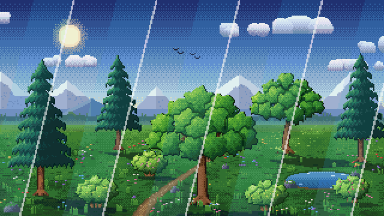

If every clump moved at once, the tree would just wobble. So the phase is **a function of position**:

```js
along(p) = p.x + 0.25 * p.y                    // direction the wind travels (slightly tilted)
a        = 2π * (t / 1.54 - along(p) / 69)     // period 1.54 s, wavelength 69 px
```

Crests run downwind at 69 / 1.54 ≈ **45 px/s**, so motion rolls across each tree from its left clumps to its right ones. The white diagonal lines in the GIF are the crests.

---

## ⑤ Gusts, with still air between them

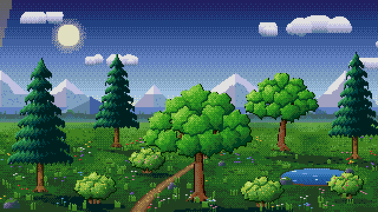

Wind strength is the sum of **six Gaussian gusts** crossing the map on a 20-second pattern ([`src/core/wind.js`](src/core/wind.js)):

```js
// [enter_time, speed px/s, center_y, half_height (0 = whole map), length px, strength]
[18.6, 65,   0,  0, 44, 1.25]   // the big one, whole map
[19.8, 65,   0,  0, 26, 0.50]   // a follow-up 1.2 s later
[ 1.5, 60,  95, 45, 30, 0.60]   // band gusts…
[ 6.0, 55, 150, 60, 34, 0.75]
[ 7.3, 55, 145, 65, 30, 0.90]
[ 8.5, 50,  50, 55, 30, 0.55]

path = speed * 20
d    = wrap(along(p) - speed * (t - enter), -path/2, path/2)
a    = strength * exp(-(d / (length * spread))²)
if (half_height > 0) a *= exp(-((p.y - center_y) / (half_height * (spread > 1 ? 1.6 : 1)))²)

gust(p)   = Σ a   (spread = 1)                 // sharp gusts
breeze(p) = min(1.6 * Σ a (spread = 2.2), 1)   // the softer air around them
```

- **No noise anywhere.** As the article puts it, random timing and constant small motion read as jitter. Between gusts the air is **truly still** and the trees stop — and that calm is what makes the gusts land.
- Gusts with a `half_height` only cross a band of the screen (just the back trees, or just the front). In the GIF, orange-to-red bands sweep left to right.

---

## ⑥ The whole tree leans on a damped spring

Every frame each tree chases **the gust at its foot** with a damped spring on `lean` (px) ([`src/core/tree.js`](src/core/tree.js)):

```js
w0      = 2π / spring_period
target  = push * gust(foot)
lean_v += (w0² * (target - lean) - 2 * damping * w0 * lean_v) * dt
lean   += lean_v * dt
```

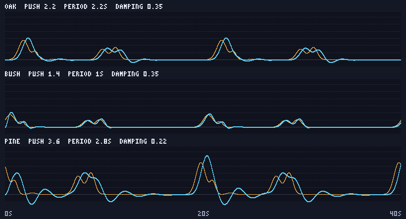

Orange = target (`push × gust at the foot`), cyan = actual lean. When a gust arrives the tree leans **late**, **overshoots** (even below zero) and swings back.
Compared with the oak (period 2.2 s, damping 0.35), the bush (1.0 s) is snappy and the pine (2.8 s, damping 0.22) rocks slower and further. That per-species "weight" is what makes the same wind look different on each tree.

---

## ⑦ The pine bends its trunk, row by row

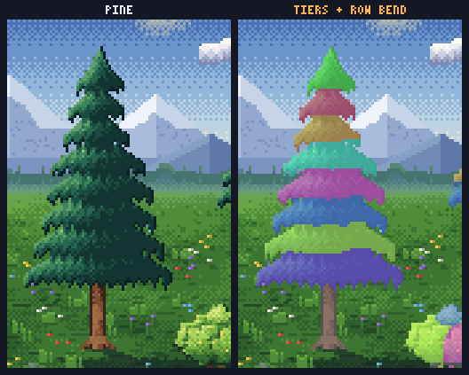

Broadleaf trunks stay still, but a tall pine flexes. The article uses a Godot canvas_item shader (`row_bend.gdshader`); here the CPU **shifts each row sideways** while drawing:

```js
up    = 1 - (y + 0.5) / H        // 0 at the foot, 1 at the tip
shift = round(lean * up^2)       // the tip moves most
```

It applies to the trunk and inside layers only; the tiers (clumps) ride `ride = lean × hn²` (`trunk_bend = 1`), the same curve, so tiers and trunk bend together without tearing.

---

## ⑧ Everything else rides the same wind

The whole landscape reads **one wind field**, so everything stays in sync:

- **Grass streaks** turn one flat shade lighter while a gust passes — you can watch the wind cross the meadow
- **Tufts & flowers** walk the same one-pixel loop as the clumps (only their tips move)
- **Falling leaves** are shed only during gusts, in the colour of the clump they came from; 2 px each, flipping between flat (2×1) and edge-on (1×2) as they fall, then resting on the grass for a while
- **The pond** gets dark cat's-paw ripples when a gust crosses it
- **Shadows** project each tree's **current pose** onto the ground (sheared to the lower-right and squashed); written to a mask first so overlaps never double-darken
- **Clouds** drift with the wind strength

---

## Why this method

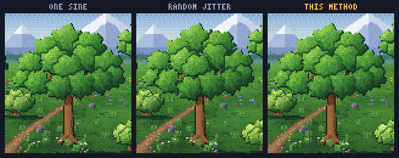

| Method | How it reads |
|---|---|
| **ONE SINE** (whole canopy on one sine) | the canopy slides side to side as one block; the trunk joint looks wrong and the wind never "travels" |
| **RANDOM JITTER** | constant fizzing — it looks like shivering, not wind |
| **THIS METHOD** (wave + gusts + spring) | calm most of the time; a gust rolls in from the left, the tree leans late and swings back |

Switch between them under "Animation method" on the page.

---

## Parameters

| Tree | push | spring_period | damping | inner_stiffness | trunk_bend | split min_dist / min_size / trunk_part |
|---|---|---|---|---|---|---|
| oak | 2.2 | 2.2 s | 0.35 | 0.35 | 0 | 5 / 25 / 0.4 |
| bush | 1.4 | 1.0 s | 0.35 | 0.35 | 0 | 3 / 10 / 0 |
| pine | 3.6 | 2.8 s | 0.22 | 0.35 | 1 | 5 / 25 / 0.12 * |

| Wind | Value |
|---|---|
| loop | 20 s |
| wave period / wavelength | 1.54 s / 69 px (≈ 45 px/s) |
| pose update | 0.1 s (10 Hz) |
| canvas | 320 × 180, trees ≈ 100 px tall |

\* The painted pine has tiers almost down to the ground, so it uses `trunk_part = 0.12` and a leaf band of the top 86 % (with the article's values its two lowest tiers would be treated as trunk).
\* One small addition to the article's method: leaf pixels the 4-connected watershed can't reach (diagonal-only contact) join a neighbouring clump.

---

## Files

```
index.html / style.css      the web page (runs as-is on GitHub Pages)
src/
  main.js                   UI, main loop, graph, pipeline viewer
  i18n.js                   Japanese / English strings
  core/
    treegen.js              procedural tree painter (oak, pine, bush)
    split.js                split pipeline (Gaussian, local maxima, watershed, add_outline, layers)
    wind.js                 wind field (traveling wave, six gusts)
    tree.js                 tree (spring, one-pixel loop, pine row bend, shadow)
    scene.js                the landscape (sky, clouds, mountains, meadow, pond, tufts, flowers, leaves, overlays)
    image.js / color.js     tiny software framebuffer and colour helpers
    rng.js / palette.js     seeded random, noise, Bayer dither / palettes
tools/
  capture.mjs               renders every README image and GIF straight from the simulation
  encode.mjs                dependency-free PNG and animated-GIF encoders (LZW, delta frames)
  font.mjs                  3×5 pixel font for labels inside figures
  serve.mjs                 static server for local preview
docs/images/                README figures (all written by capture.mjs)
```

`src/core/` has no DOM dependency, so the same code runs in the browser and in Node. Every README figure is produced by running **the page's own code** in Node with a fixed 60 Hz step and a fixed seed.

---

## Run it locally

Any Node.js 18+; nothing to install.

```bash
node tools/serve.mjs 8791
```

Open http://localhost:8791 (it uses ES modules, so serve it rather than opening `file://`).

To regenerate the README figures:

```bash
node tools/capture.mjs
```

URL parameters: `?seed=42` (tree seed), `?t=18` (start time), `?lang=en` (English UI).

---

## Credits / license

- Technique: SpriteCook, *[How to make pixel art trees move in the wind](https://www.spritecook.ai/blog/pixel-art-trees-wind-animation)* (its numbers and gust table are used here)
- Related reading the article points to: Raymond Schlitter "Pixelblog 33: Wind Effects", Nekoto "Fluffy Pixel Art Trees", godotshaders.com "2D Pixel perfect wind & sway effect"
- Code and art: written from scratch for this repository. [MIT License](LICENSE)
