# Pixel Art Tree Wind Lab 🌳💨

**日本語** | [English](README.en.md)

ピクセルアートの木を「それっぽく」風で揺らすための技術を、ブラウザ上でまるごと再現し、分解して見られるようにしたラボです。
依存ライブラリはゼロ。素の JavaScript（ES Modules）だけで、木の絵の生成 → クランプ分割 → 風のシミュレーション → 描画まで全部動いています。

### ▶ [ブラウザで遊ぶ（GitHub Pages）](https://kumi0708.github.io/pixel-art-tree-wind-lab/)

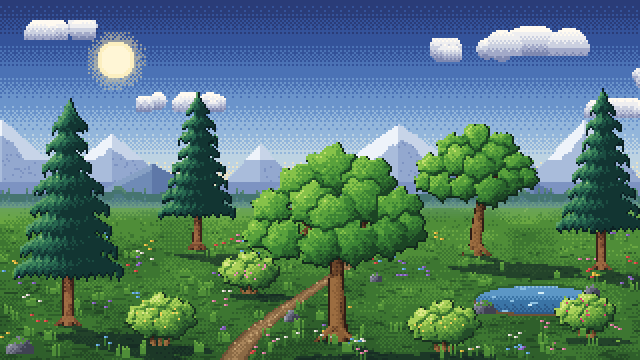

> 手法の出典：SpriteCook のブログ記事 **[How to make pixel art trees move in the wind](https://www.spritecook.ai/blog/pixel-art-trees-wind-animation)**。
> 記事では Python（numpy / scipy / scikit-image）で木を分割し、Godot で動かしています。このリポジトリでは同じ考え方を **JavaScript だけで** 実装し直し、木の絵も手続き生成で描き起こしました。コードと絵はすべてこのリポジトリのために新しく書いたものです。

---

## 目次

1. [できること](#できること)
2. [全体の流れ](#全体の流れ)
3. [① 木を1枚絵として描く（手続き生成）](#-木を1枚絵として描く手続き生成)
4. [② キャンバスを「葉の塊（クランプ）」に分割する](#-キャンバスを葉の塊クランプに分割する)
5. [③ 各クランプは「1ピクセルのループ」を歩く](#-各クランプは1ピクセルのループを歩く)
6. [④ タイミングは「進行波」で決める](#-タイミングは進行波で決める)
7. [⑤ 突風と、その間の静けさ](#-突風とその間の静けさ)
8. [⑥ 木全体は減衰バネで傾く](#-木全体は減衰バネで傾く)
9. [⑦ マツは幹ごと曲がる（行ずらし）](#-マツは幹ごと曲がる行ずらし)
10. [⑧ 画面のほかの部分も同じ風で動く](#-画面のほかの部分も同じ風で動く)
11. [なぜこの方法なのか（ダメな例との比較）](#なぜこの方法なのか)
12. [パラメータ一覧](#パラメータ一覧)
13. [ファイル構成](#ファイル構成)
14. [ローカルで動かす / 画像を再生成する](#ローカルで動かす)

---

## できること

Web ページ上で次のことをリアルタイムに試せます。

| 機能 | 内容 |
|---|---|
| **表示切替** | 通常 / クランプを色分け / 揺れやすさ `w` をヒートマップ表示 |
| **オーバーレイ** | 突風フィールド（ヒートマップ）・進行波の位相（白い線が波頭） |
| **方式の比較** | 記事の手法 / 全体を1つの sin で揺らす / ランダムに震わせる |
| **構成要素の ON/OFF** | 進行波・突風・バネ・inside レイヤー・10Hz ステップ・影・落ち葉 |
| **ワールド** | 再生速度、風の強さ、シード変更で木を作り直し（分割もその場で再実行） |
| **グラフ** | 選んだ木の「目標の傾き」と「実際の傾き」をリアルタイムでプロット |
| **分割パイプライン** | 9段階の中間画像をブラウザ内で生成して表示 |

ステージ上の木をクリックすると、その木をグラフで追えます。スペースキーで一時停止。
開発者ツールのコンソールでは `lab.scene` から状態を直接いじれます（例：`lab.scene.trees[5].p.push = 6`）。

---

## 全体の流れ

```
 ┌──────────────┐   ┌─────────────────────┐   ┌───────────────────────┐   ┌──────────────┐
 │ 1枚絵の木     │ → │ オフライン分割        │ → │ 毎フレームの風         │ → │ 320×180 に    │
 │ (手続き生成)  │   │ 色マスク→ぼかし→     │   │ 進行波 + 突風 + バネ   │   │ 整数座標で描画 │
 │ treegen.js   │   │ シード→watershed     │   │ wind.js / tree.js     │   │ → 最近傍で拡大 │
 └──────────────┘   │ split.js            │   └───────────────────────┘   └──────────────┘
                    └─────────────────────┘
```

ポイントは **「幹は動かさない」「動かすのは葉の塊だけ」「動きは必ず整数ピクセル」「乱数は使わない」** の4つです。
描画はすべて自前の小さなソフトウェア・フレームバッファ（`Uint32Array`）に 320×180 で行い、最後に CSS の `image-rendering: pixelated` で拡大しています。だから座標は構造的に必ず整数になり、サブピクセルのにじみが出ません。

---

## ① 木を1枚絵として描く（手続き生成）

元の記事は「画家が描いた木のスプライト」から出発します。ここにはアーティストがいないので、**1枚のフラットな画像として木を描く** ところから自前でやっています（[`src/core/treegen.js`](src/core/treegen.js)）。
重要なのは、生成器が分割器に「どこがクランプか」を **一切教えない** ことです。分割器は色と明るさだけを手がかりに、自力でクランプを見つけ直します。

- **幹・枝**：先細りのカプセルを何本も描き、各画素で「最も近い枝の軸」を採用。円柱として照明（光源は左上）を計算し、5段階のトーンにディザで量子化。太い枝には輪郭線、樹皮の溝はハッシュノイズ。
- **樹冠（カシ・低木）**：「パフ（もこもこの球）」を奥→手前の順に重ねます。各パフは **小さな球として個別にライティング** されるので、パフごとに明るい芯（ハイライト）ができます。これが後で分割器がクランプを見つける手がかりになります。
  - 外周を `sin(6θ)` `sin(11θ)` で揺らしてギザギザの葉のシルエットに
  - 手前のパフが重なる位置の奥側を暗くする（アンビエントオクルージョン）
  - 4×4 Bayer ディザで7色パレットに量子化
  - 右下側だけ暗い輪郭を入れる「セレクティブアウトライン」と、シルエットからはみ出す葉っぱ1ピクセル
- **マツ**：垂れ下がる枝の段（ティア）を8段積み、段ごとに左上から照らし、上の段の真下を影にします。下端はノコギリ状。

---

## ② キャンバスを「葉の塊（クランプ）」に分割する

[`src/core/split.js`](src/core/split.js) は記事の Python パイプライン（numpy / scipy / scikit-image）を JavaScript に移植したものです。Web ページの「分割パイプライン」欄では、これがブラウザ内でその場で実行されます（カシ1本で数ミリ秒）。

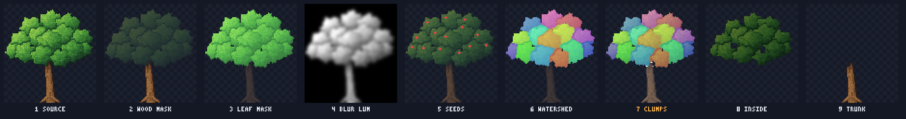

| # | 段階 | やっていること |
|---|---|---|
| 1 | SOURCE | 手続き生成した1枚絵 |
| 2 | WOOD MASK | **木部** = 色相 5〜40°・彩度 > 0.22・輝度 < 125。**白い樹皮** = 彩度 < 0.16・輝度 > 95（白で表示） |
| 3 | LEAF MASK | **葉** = 不透明 かつ 木部でも樹皮でもない かつ スプライトの不透明行範囲の **上 78%** |
| 4 | BLUR LUM | 輝度を σ = 1.6 のガウシアンでぼかす（`scipy.ndimage.gaussian_filter` 相当、分離可能カーネル） |
| 5 | SEEDS | ぼかした輝度の **局所極大** をシードに（`skimage.feature.peak_local_max`、最小距離 5px。低木は 3px） |
| 6 | WATERSHED | `watershed(-blur, seeds, mask=leaves)`：明るい芯から、次に明るい隣接画素へと優先度付きキューで塗り広げる（4近傍） |
| 7 | CLUMPS | 小さすぎる塊（25px 未満、低木は 10px）と、低すぎる塊（平均 y が `最下行 − 高さ×trunk_part` より下）を幹へ戻す。**白** = `add_outline` で付け替えた輪郭画素 |
| 8 | INSIDE | 全クランプの和集合を 2px 収縮し、RGB × 0.55 で暗くした層 |
| 9 | TRUNK | どのクランプにも属さない画素 = 動かない層 |

**add_outline（reach 2）**：シルエット際（2px 以内に透明がある）の茶色い画素は、幹の本体や白い樹皮より近ければ、隣のクランプに付け替えます。これで樹冠からはみ出した小枝の先が葉と一緒に動き、葉だけが動いて茶色い縁が置き去りになるのを防ぎます。

結果として、このシードのカシは **14 クランプ**、マツは **8 段**、低木は **4 クランプ** になりました（記事の例と同じ数）。

<table>
<tr>
<td>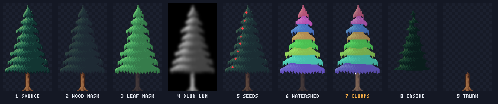</td>
</tr>
<tr>
<td>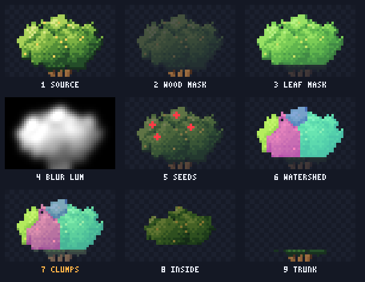</td>
</tr>
</table>

分割後のレイヤーを分解するとこうなります。描画順は **inside → 幹 → クランプ**（マツは下の段から上へ、広葉樹は奥＝上から手前＝下へ）。

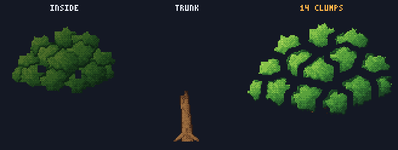

### inside レイヤーがなぜ必要か

クランプが動くと、元いた場所に穴が開いて空や背景が透けて見えます。そこで樹冠の内側に「一回り小さくて暗い」層を敷いておき、隙間から見えるのを **樹冠の奥の暗がり** にします。

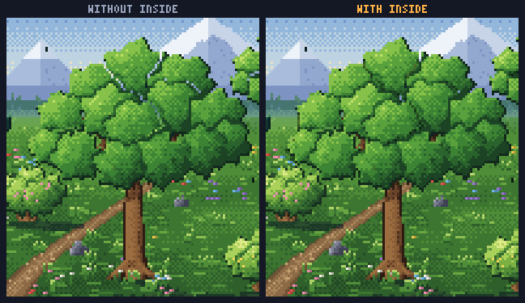

左（inside なし）はクランプの境目から空色・背景が覗いていますが、右（inside あり）では奥の葉の影に見えます。

---

## ③ 各クランプは「1ピクセルのループ」を歩く

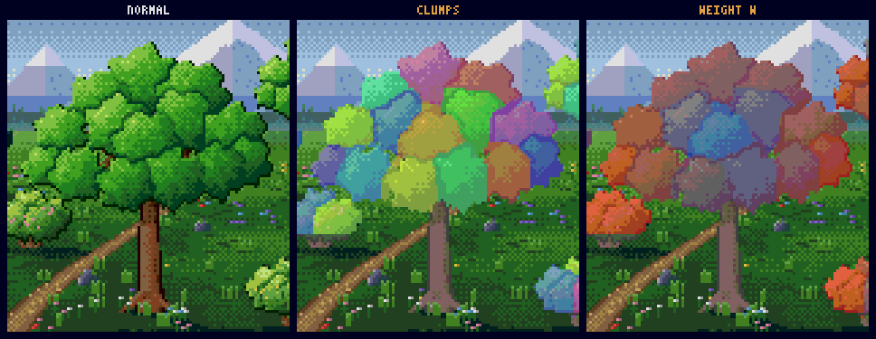

各クランプは 0.1 秒ごと（10Hz）にポーズを更新し、次の式で整数オフセットを決めます（`a` は後述の波の位相）。

```js
ride = lean * lerp(w, hn * hn, trunk_bend)          // 木全体の傾きに乗る分
dx   = ride + w * (0.9 * breeze + 1.3 * gust) * (0.5 - 0.5 * cos(a))
dy   =      - w * (0.75 * breeze + 0.5 * gust) * max(sin(a), 0)
pos  = rest + (round(dx), round(dy))
```

`breeze = 1, gust = 0, w = 1` のとき、1周期で **(0,0) → (0,−1) → (1,−1) → (1,0)** と、上 → 右 → 下 → 戻る の小さな四角を描きます。`w = 0.35`（樹冠の内側）なら丸めで (0,0) のまま動きません。

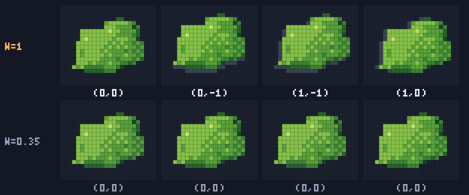

- **揺れやすさ `w`** = `lerp(inner_stiffness=0.35, 1, 樹冠中心からの正規化距離)`。外周のクランプほど大きく、内側ほど硬い（上の GIF の右パネル：青 = 硬い、赤 = 柔らかい）。
- **ポーズは 10Hz**：毎フレーム動かすより、ピクセルアートらしい「コマ送り」の質感になります（ページで「10Hz」を OFF にすると違いがわかります）。

---

## ④ タイミングは「進行波」で決める

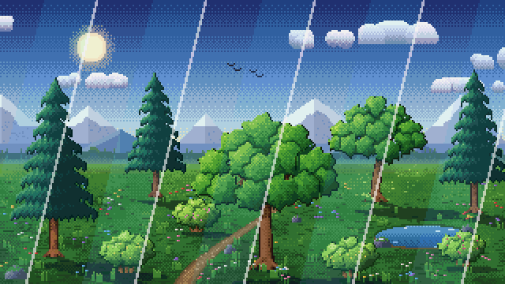

全クランプが同時に動くと「木全体がぷるぷるするだけ」になります。そこで位相を **場所の関数** にします。

```js
along(p) = p.x + 0.25 * p.y                                  // 風の進む向き（少し斜め）
a        = 2π * (t / 1.54 - along(p) / 69)                   // 周期 1.54 s、波長 69 px
```

波頭は 69 / 1.54 ≈ **45 px/s** で風下へ進み、1本の木の中でも左のクランプから右のクランプへと揺れが「流れて」いきます。上の GIF の白い斜線が波頭です。

---

## ⑤ 突風と、その間の静けさ

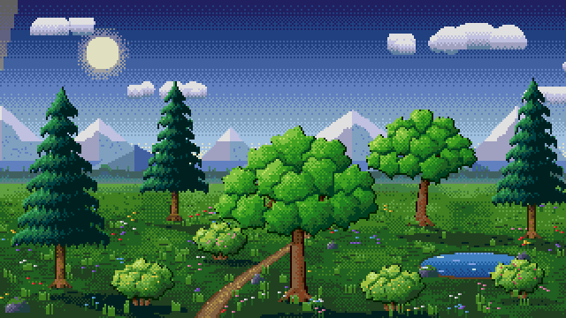

風の強さは **6つのガウス型の突風** の和です。20 秒周期でマップを横切ります（[`src/core/wind.js`](src/core/wind.js)）。

```js
// [登場時刻, 速さ px/s, 中心y, 半分の高さ(0=全域), 長さ px, 強さ]
[18.6, 65,   0,  0, 44, 1.25]   // 大きな突風（全域）
[19.8, 65,   0,  0, 26, 0.50]   // その1.2秒後の追い風
[ 1.5, 60,  95, 45, 30, 0.60]   // 帯状の突風…
[ 6.0, 55, 150, 60, 34, 0.75]
[ 7.3, 55, 145, 65, 30, 0.90]
[ 8.5, 50,  50, 55, 30, 0.55]

path = speed * 20
d    = wrap(along(p) - speed * (t - enter), -path/2, path/2)
a    = strength * exp(-(d / (length * spread))²)
if (half_height > 0) a *= exp(-((p.y - center_y) / (half_height * (spread > 1 ? 1.6 : 1)))²)

gust(p)   = Σ a  (spread = 1)               // 鋭い突風
breeze(p) = min(1.6 * Σ a (spread = 2.2), 1) // 突風の前後に広がるそよ風
```

- **ノイズは一切使っていません**。記事いわく、ランダムなタイミングや常に続く小さな揺れは「ジッター」に見えてしまう。突風と突風の間は **本当に無風** で、木は止まります。その静けさがあるから突風が効いて見えます。
- `half_height` を持つ突風は画面の一部の帯（奥の木だけ・手前だけ）を通ります。上の GIF ではオレンジ〜赤の帯が左から右へ流れていきます。

---

## ⑥ 木全体は減衰バネで傾く

各木は **根元の突風** を目標に、毎フレーム減衰バネで傾き `lean`（px）を更新します（[`src/core/tree.js`](src/core/tree.js)）。

```js
w0      = 2π / spring_period
target  = push * gust(foot)
lean_v += (w0² * (target - lean) - 2 * damping * w0 * lean_v) * dt
lean   += lean_v * dt
```

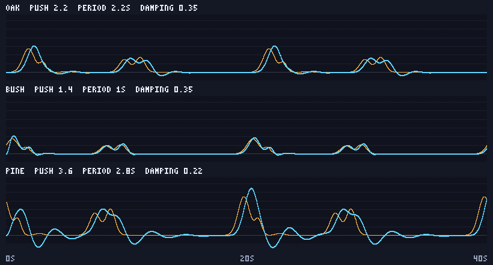

オレンジ = 目標（`push × 根元の突風`）、水色 = 実際の傾き。突風が来ると **少し遅れて** 傾き、**行き過ぎて**（マイナス側にも）戻ってきます。
カシ（周期 2.2s・減衰 0.35）に比べ、低木（1.0s）はキビキビ、マツ（2.8s・減衰 0.22）は大きくゆっくり揺れ戻ります。この「木の種類ごとの重さ」が、同じ風でも違う動きを生みます。

---

## ⑦ マツは幹ごと曲がる（行ずらし）

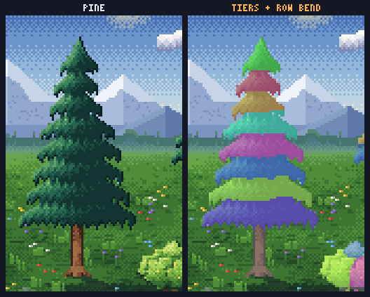

広葉樹は幹を動かしませんが、マツは細長いので幹ごとしならせます。記事では Godot の canvas_item シェーダ（`row_bend.gdshader`）ですが、ここでは CPU で **行ごとに横へずらして** 描きます。

```js
up    = 1 - (y + 0.5) / H        // 根元 0 → 先端 1
shift = round(lean * up^2)       // 先端ほど大きくずれる
```

幹と inside レイヤーにだけ適用し、段（クランプ）のほうは `ride = lean × hn²`（`trunk_bend = 1`）で同じカーブに乗ります。だから段と幹がズレずに一緒にしなります。

---

## ⑧ 画面のほかの部分も同じ風で動く

風景全体が **同じ風のフィールド** を参照するので、すべてが同期して見えます。

- **草のスジ**：突風が通過している間だけ、1段明るい色に切り替わる（「風が草原を渡っていく」線）
- **草むら・花**：クランプと同じ1ピクセルループで先端だけが揺れる
- **落ち葉**：突風の最中だけ、そのクランプの色の葉を落とす。2px で、平ら（横2px）と真横（縦2px）を交互に切り替えてひらひら。着地してしばらく残る
- **池**：突風が水面を通ると暗いさざ波（キャッツポー）が立つ
- **影**：木の **現在のポーズ** を地面へ投影（右下へせん断＋縦につぶす）。重なっても二重に暗くならないよう、マスクに書いてから1回だけ暗くする
- **雲**：風の強さに応じてゆっくり流れる

---

## なぜこの方法なのか

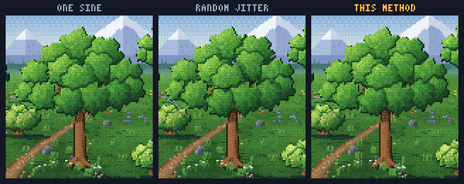

| 方式 | 見え方 |
|---|---|
| **ONE SINE**（全体を1つの sin で揺らす） | 樹冠がまとめて左右に滑るだけ。幹との境目が不自然で、風が「流れて」こない |
| **RANDOM JITTER**（ランダムに震わせる） | 常にざわざわして、風ではなく「震え」に見える |
| **THIS METHOD**（進行波＋突風＋バネ） | 普段は静か。突風が来ると左から順に揺れが伝わり、木が遅れて傾き、揺り戻す |

ページの「アニメーション方式」で実際に切り替えて比べられます。

---

## パラメータ一覧

| 木 | push | spring_period | damping | inner_stiffness | trunk_bend | 分割 min_dist / min_size / trunk_part |
|---|---|---|---|---|---|---|
| カシ (oak) | 2.2 | 2.2 s | 0.35 | 0.35 | 0 | 5 / 25 / 0.4 |
| 低木 (bush) | 1.4 | 1.0 s | 0.35 | 0.35 | 0 | 3 / 10 / 0 |
| マツ (pine) | 3.6 | 2.8 s | 0.22 | 0.35 | 1 | 5 / 25 / 0.12 ※ |

| 風 | 値 |
|---|---|
| ループ | 20 s |
| 波の周期 / 波長 | 1.54 s / 69 px（≈ 45 px/s） |
| ポーズ更新 | 0.1 s（10Hz） |
| キャンバス | 320 × 180、木の高さ ≈ 100 px |

※ マツは段が根元近くまで来るこの絵に合わせて `trunk_part = 0.12`、葉の範囲を上 86% にしています（記事の値だと下の2段が幹扱いになるため）。
※ 記事の方法に加えた小さな工夫：watershed が4近傍で届かなかった（斜めにだけ接している）葉の画素を、隣のクランプに吸収させています。

---

## ファイル構成

```
index.html / style.css      Web ページ（GitHub Pages でそのまま動く）
src/
  main.js                   UI、ループ、グラフ、パイプライン表示
  i18n.js                   日本語 / 英語テキスト
  core/
    treegen.js              木の手続き生成（カシ・マツ・低木）
    split.js                分割パイプライン（ガウシアン・極大点・watershed・add_outline・レイヤー化）
    wind.js                 風のフィールド（進行波・6つの突風）
    tree.js                 木（バネ・1ピクセルループ・マツの行ずらし・影）
    scene.js                風景全体（空・雲・山・草原・池・草・花・落ち葉・オーバーレイ）
    image.js / color.js     小さなソフトウェア・フレームバッファと色ユーティリティ
    rng.js / palette.js     シード付き乱数・ノイズ・Bayer ディザ / パレット
tools/
  capture.mjs               README の画像・GIF をシミュレーションから直接生成
  encode.mjs                依存なしの PNG / アニメーション GIF エンコーダ（LZW、差分フレーム）
  font.mjs                  画像内ラベル用 3×5 ピクセルフォント
  serve.mjs                 ローカル確認用の静的サーバー
docs/images/                README 用の画像（すべて capture.mjs が出力）
```

`src/core/` は DOM に依存しないので、ブラウザと Node の両方で同じコードが動きます。README の画像はすべて **ページと同じコード** を Node で固定ステップ（60Hz）・固定シードで回して書き出したものです。

---

## ローカルで動かす

Node.js 18 以上があれば、インストール不要です。

```bash
node tools/serve.mjs 8791
```

ブラウザで http://localhost:8791 を開きます（ES Modules を使うので `file://` 直開きではなくサーバー経由で）。

README の画像を作り直すには：

```bash
node tools/capture.mjs
```

URL パラメータ：`?seed=42`（木のシード）、`?t=18`（開始時刻）、`?lang=en`（英語 UI）。

---

## クレジット / ライセンス

- 手法：SpriteCook, *[How to make pixel art trees move in the wind](https://www.spritecook.ai/blog/pixel-art-trees-wind-animation)*（記事内の数値・突風テーブルを使用）
- 記事が参照している関連資料：Raymond Schlitter「Pixelblog 33: Wind Effects」、Nekoto「Fluffy Pixel Art Trees」、godotshaders.com「2D Pixel perfect wind & sway effect」
- コードと絵：このリポジトリのために新規に作成。[MIT License](LICENSE)
